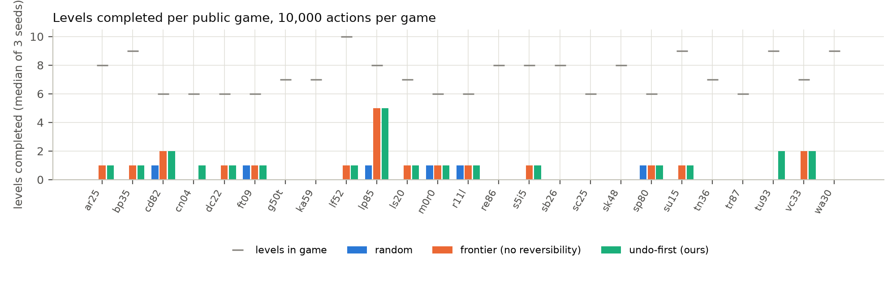
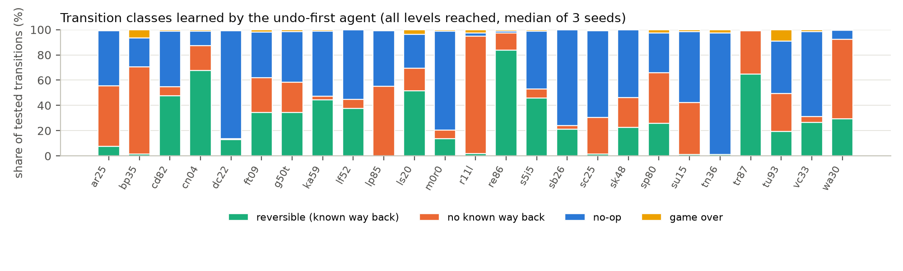

# Undo-first exploration for ARC-AGI-3

**Reversibility-aware frontier search**: a training-free, LLM-free agent for the ARC-AGI-3 interactive
benchmark that learns which of its actions can be taken back, probes those first, and measures how
reversible the 25 public games are. Written for the ARC Prize 2026 paper track.

- Paper: [paper/paper.pdf](paper/paper.pdf) (4 pages; LaTeX source in `paper/`)
- Kaggle writeup text: [writeup.md](writeup.md)
- Notebook (agent + runner inlined, runs offline, outputs included): [notebooks/undo_agent.ipynb](notebooks/undo_agent.ipynb)
- Agent: [agent/undo_agent.py](agent/undo_agent.py) (one file, numpy only)



## Results (25 public games, 10,000 actions per game, 3 seeds)

| mode | score (official formula, 0-100) | levels of 183 (per seed) | games with a level | median actions per solved level | deliberate resets (3 seeds) |
|---|---|---|---|---|---|
| random (Kaggle starter) | 0.10 | 7 (7, 6, 7) | 6/25 | 2,088 | - |
| frontier, no reversibility | 0.37 | 19 (18, 19, 21) | 12/25 | 644 | 27,112 |
| **undo-first (ours)** | 0.38 | **22 (21, 22, 24)** | **15/25** | 812 | **20,048** |

The reversibility terms add about one level in six on every seed, three more games entered and 26% fewer
deliberate resets, at the cost of more actions per solved level, so the official score does not move:
with hundreds of actions per level against human baselines of 6 to 578, RHAE is near zero for any explorer
without a model of the goal. Measured over all levels reached: 40% of tested transitions are no-ops, 30% have
a known way back, 29% have none, 1% end the game.



## How it works

1. **State**: the last rendered 64x64 frame, hashed after a learned mask zeroes the step-counter row
   (an edge row that changes by at most two cells in one transition).
2. **Actions**: keys as given; `ACTION6` becomes one click per connected colour component (at most 40).
3. **Graph**: per level, every tested (state, action) is a no-op, fatal, or a successor; a successor edge
   becomes *reversible* once any tested edge leads back.
4. **Priors per action type** (survive level changes): responsiveness, reversibility rate, winning-path
   membership; plus inverse pairs and whether `ACTION7` really undoes.
5. **Policy**: probe untested actions ordered by winning path, predicted reversibility, responsiveness;
   otherwise route to the cheapest frontier, where cost = travel + (1 - p_rev) x (RESET + replay).

`frontier` mode is the identical code with the reversibility terms off; `random` is the Kaggle starter policy.

## Run it

```
python3.12 -m venv .venv && . .venv/bin/activate && pip install arc-agi numpy matplotlib nbformat
# cache the 25 public games once (anonymous API key, network needed only here)
cd games && python -c "from arc_agi import Arcade, OperationMode; a=Arcade(operation_mode=OperationMode.NORMAL); [a.make(e.game_id) for e in a.get_environments()]" && cd ..
python run_local.py --mode undo --seed 0 --max-actions 10000 --workers 8 --out results/undo-s0.json
python make_figures.py && (cd paper && tectonic paper.tex)
```

One mode over all 25 games takes 5 to 15 minutes on 8 CPU workers. The notebook does the same end to end.

## Notes

- No game-specific code, no network at run time, no exploitation of the null-coordinate crash that
  Liew (arXiv 2605.25931) reports the public engine misreports as a win.
- This entry has no ARC-AGI-3 code-competition submission, so there is no private-set score.
- Writing and code were produced with AI assistance (Claude Code); every number was measured by the notebook.

## Cite

```
@misc{shahithakuri2026undofirst,
  title  = {Undo-First Exploration: Reversibility-Aware Frontier Search for ARC-AGI-3},
  author = {Shahi Thakuri, Sundar},
  year   = {2026},
  note   = {ARC Prize 2026 paper track. https://github.com/sundarshahi/undo-first-arc-agi-3}
}
```

License: CC BY 4.0.
